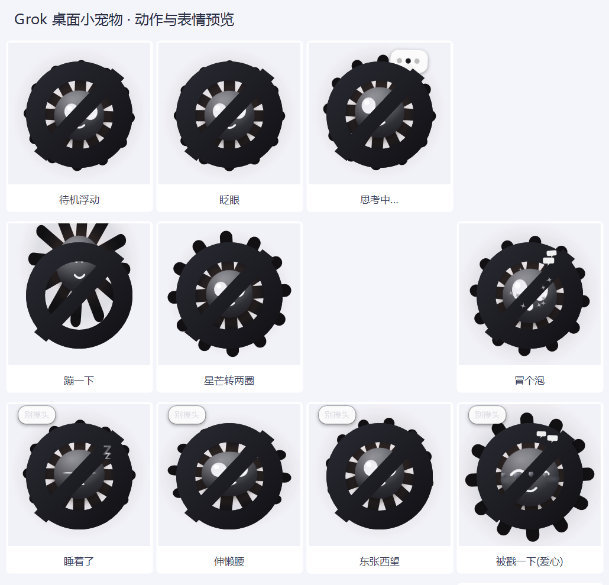

# Grok 桌面小宠物 ⚔

一只趴在你桌面上的 **Grok（xAI）小宠物**：黑色圆环 + 一道斜杠（照 Grok 标志做的），中间是它的脸。会浮动、眨眼、转圈、思考、睡着，还能和其他九只 AI 桌宠**打招呼、聊天、吵架和好、以及一对一打架**。

- **零依赖**：只用 Windows 自带的 WPF + PowerShell
- **不抢焦点**：`WS_EX_NOACTIVATE | WS_EX_TOOLWINDOW`

## 快速开始
1. 双击 **`启动宠物.vbs`**（无控制台），出现在屏幕右下角；被拦截就用 **`启动宠物.bat`**
2. 左键点一下 = 戳它 · 拖动 = 换位置 · 右键 = 菜单（打招呼 / 摸摸头 / **挑战最近的宠物 ⚔** / 大小 / 退出）
3. 开机自启：`启动宠物.vbs` 的快捷方式丢进 `shell:startup`

## 对战
- **手动**：右键 →「挑战最近的宠物 ⚔」
- **自动**：靠近别的宠物时约 4% 概率自己打起来（120 秒冷却）
- 规则：双方各 100 血，每 1.1~1.7 秒出一次手，伤害 9~19；先掉光血的输
- 台词在 `lines.json` 的 `Challenge / Attack / Hurt / Win / Lose`

## 联动
共享内存 `DesktopPets.Interop.v5`（10 槽位）：见面打招呼、真对话（带话题记忆）、说话气泡、一起玩、传爱心、追逐、吵架和好、排排站、串门、让位、对战。

## License
MIT